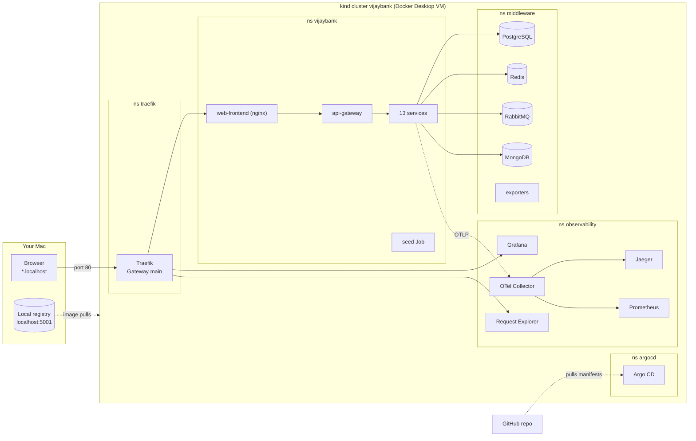
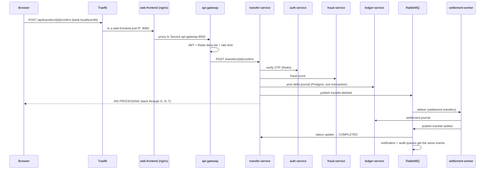
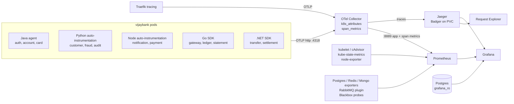

# VijayBank on Kubernetes — end-to-end guide

How the fictional VijayBank net-banking platform runs on a local Kubernetes cluster: what is
deployed, how a request travels through it, how it is packaged (Helm) and delivered (Argo CD),
how it is observed (OpenTelemetry, Jaeger, Prometheus, Grafana), and how to operate and
troubleshoot it. Demo data only; no real bank, customers or money.

**Contents**

1. [Overview](#1-overview)
2. [Architecture](#2-architecture)
3. [The application](#3-the-application)
4. [How a request flows](#4-how-a-request-flows)
5. [Repository layout](#5-repository-layout)
6. [Setup from scratch](#6-setup-from-scratch)
7. [Helm charts](#7-helm-charts)
8. [Secrets](#8-secrets)
9. [Argo CD and GitOps](#9-argo-cd-and-gitops)
10. [Observability](#10-observability)
11. [Testing](#11-testing)
12. [Day-to-day operations](#12-day-to-day-operations)
13. [Troubleshooting](#13-troubleshooting)
14. [Reference: versions, resources, URLs](#14-reference)

---

## 1. Overview

| | |
|---|---|
| **Application** | 13 microservices + React web frontend in Go, Java, Kotlin, Python, Node.js and .NET; PostgreSQL, Redis, RabbitMQ, MongoDB |
| **Cluster** | [kind](https://kind.sigs.k8s.io/) cluster `vijaybank`: 1 control-plane + 2 worker nodes (Kubernetes 1.35) running as Docker containers |
| **Images** | Built locally, pushed to a local registry `localhost:5001` that the nodes pull from |
| **Ingress** | Traefik with the Kubernetes **Gateway API** (`Gateway` + `HTTPRoute`) |
| **Packaging** | **Helm**: one shared chart (`generic-application`) + one thin chart per service |
| **Delivery** | **Argo CD**: app of apps + ApplicationSet; everything is synced from this Git repo |
| **Observability** | OpenTelemetry Collector → **Jaeger** (traces) + **Prometheus** (metrics, via the Prometheus Operator in kube-prometheus-stack) → **Grafana** dashboards; plus the **Request Explorer** |

The application code is a copy of the Docker Compose version
([Banking-observability](https://github.com/vijaykumarbirru/Banking-observability)); this repo
only adds what Kubernetes needs. No application code was changed: every service already read
its connections from environment variables.

---

## 2. Architecture

### 2.1 Cluster and namespaces



| Namespace | What runs there |
|---|---|
| `traefik` | Traefik (ingress controller) and the shared `Gateway` named `main` |
| `argocd` | Argo CD (server, repo-server, application controller, ApplicationSet controller, Redis) |
| `middleware` | PostgreSQL, Redis, RabbitMQ, MongoDB (StatefulSets) + their Prometheus exporters |
| `vijaybank` | The 13 services, the web frontend and the seed Job |
| `observability` | OpenTelemetry Collector, Jaeger, Prometheus Operator, Prometheus, Grafana, kube-state-metrics, node-exporter, Blackbox exporter, Request Explorer |

### 2.2 Nodes and ports

`kind/cluster.yaml` defines 3 nodes. Only the control-plane maps ports to your Mac
(`80` and `443`), and Traefik runs there with `hostPort: 80/443`, so `http://*.localhost`
reaches Traefik. Application pods are scheduled on the two workers (the control-plane is tainted).

Every node's containerd is told that `localhost:5001` means the registry container
`vijaybank-registry` on the `kind` Docker network (`scripts/create-cluster.sh` writes a
`hosts.toml` per node), so images are stored once and pulled like from any real registry.

---

## 3. The application

| Service | Language | Port | Uses | Job |
|---|---|---|---|---|
| `web-frontend` | React + nginx | 8080 | — | Net-banking UI; nginx proxies `/api/*` to the gateway |
| `api-gateway` | Go | 8000 | Redis | JWT check, token deny-list, rate limits, routing |
| `auth-service` | Java (Spring Boot) | 8081 | Postgres, Redis, RabbitMQ | Passwords, login + step-up OTPs, JWTs |
| `customer-service` | Python (FastAPI) | 8082 | Postgres | Customer profile / KYC |
| `account-service` | Java (Spring Boot) | 8083 | Postgres, RabbitMQ | Accounts, balances, fixed deposits |
| `ledger-service` | Go | 8084 | Postgres | Double-entry ledger |
| `transfer-service` | .NET | 8085 | Postgres, RabbitMQ | Transfers, beneficiaries |
| `fraud-service` | Python (FastAPI) | 8086 | RabbitMQ | Rule-based fraud score |
| `notification-service` | Node.js | 8087 | RabbitMQ, MongoDB | SMS/email (dev inbox) |
| `audit-service` | Python | 8088 | RabbitMQ, MongoDB | Append-only audit trail |
| `statement-service` | Go | 8089 | — | Statements and PDF export |
| `payment-service` | Node.js | 8090 | Postgres, RabbitMQ | Bill payments with OTP |
| `card-service` | Kotlin (Ktor) | 8091 | Postgres, RabbitMQ | Cards: block, unblock, limits |
| `settlement-worker` | .NET | 8092 | RabbitMQ | Settles transfers asynchronously |
| `seed` (Job) | Python | — | the services' APIs | Creates customers `VB100001`–`VB100020` with accounts and history |

Every service exposes `/health/live` (process alive) and `/health/ready` (dependencies OK).
Money is held in integer paise; the ledger is double-entry; writes take idempotency keys.

---

## 4. How a request flows

Example: confirming an IMPS transfer with an OTP.



### 4.1 What happens on the network

| Hop | How it is addressed |
|---|---|
| Browser → Traefik | `bank.localhost` resolves to 127.0.0.1; Docker Desktop forwards host port 80 to the control-plane node (kind `extraPortMappings`); Traefik listens there (`hostPort`). Traefik sees the client as `172.18.0.1` (Docker's gateway on the `kind` network). |
| Traefik → nginx | The `HTTPRoute` for `bank.localhost` points at the `web-frontend` Service. Traefik reads the Service's endpoints itself and connects **straight to a pod IP** (no ClusterIP, no kube-proxy). |
| Pod → pod (e.g. gateway → transfer-service) | DNS via CoreDNS (`transfer-service.vijaybank.svc.cluster.local` → Service **ClusterIP** 10.96.x.x); kube-proxy's iptables rules DNAT the ClusterIP to one pod IP (10.244.x.x). |
| Pod → data store | Same, across namespaces: `postgres.middleware.svc.cluster.local:5432` etc. |
| Same node vs different node | Same node: routed inside the node. Different nodes: out of the node's `eth0`, across the `kind` Docker bridge (172.18.0.0/16), into the other node (kindnet CNI). |

The Request Explorer (section 10.6) shows all of this for a real request, hop by hop.

---

## 5. Repository layout

```
services/<name>/            application code + Dockerfile (13 services + web-frontend)
seed/                       seed Job code + Dockerfile
kind/cluster.yaml           cluster definition (nodes, port mappings, registry config path)
scripts/
  create-cluster.sh         registry container + kind cluster + node registry config (idempotent)
  build-images.sh           build images, optionally push to localhost:5001
  create-secrets.sh         random passwords → Kubernetes Secrets (idempotent, never in Git)
  helm-install-all.sh       install the app charts with plain Helm (without Argo CD)
  build-dashboards.py       regenerate the Grafana dashboard JSON
  smoke-test.py             end-to-end test through Traefik
charts/
  generic-application/      shared templates for every service
  <service>/                thin chart per service (values only)
  seed/                     seed Job chart
  middleware/               data stores
  observability-config/     ServiceMonitors, Probe, dashboards, alert, Request Explorer
platform/
  gateway-api/              Gateway API CRDs v1.6.1 (pinned copy)
  traefik/values.yaml       Traefik settings
  argocd/values.yaml        Argo CD settings
  observability/*.yaml      settings for Jaeger, Collector, kube-prometheus-stack, exporters
argocd/
  root-app.yaml             the one Application applied by hand (app of apps)
  apps/*.yaml               one Application per component + the services ApplicationSet
docs/GUIDE.md               this guide
```

---

## 6. Setup from scratch

### 6.1 Prerequisites

- Docker Desktop with **~10–12 GB memory** (the full stack uses about 8 GB) and some free disk
- `kind`, `kubectl`, `helm` (Homebrew: `brew install kind kubectl helm`)
- Stop other heavy stacks (e.g. the Docker Compose version) while the cluster runs

### 6.2 Steps

```bash
git clone https://github.com/vijaykumarbirru/vijaybank-kubernetes.git
cd vijaybank-kubernetes

# 1. Local registry (localhost:5001) + kind cluster "vijaybank"
./scripts/create-cluster.sh

# 2. Build the 15 images and push them to the local registry (a few minutes the first time)
./scripts/build-images.sh --push

# 3. Random passwords as Kubernetes Secrets (middleware, vijaybank, observability namespaces)
./scripts/create-secrets.sh

# 4. Gateway API CRDs, Traefik and Argo CD (Argo CD then takes these over too)
kubectl apply --server-side -f platform/gateway-api/gateway-api-v1.6.1-standard.yaml
helm repo add traefik https://traefik.github.io/charts
helm repo add argo https://argoproj.github.io/argo-helm
helm upgrade --install traefik traefik/traefik --version 41.6.0 \
  -n traefik --create-namespace -f platform/traefik/values.yaml
helm upgrade --install argocd argo/argo-cd --version 10.17.2 \
  -n argocd --create-namespace -f platform/argocd/values.yaml

# 5. Hand everything else to Argo CD
kubectl apply -f argocd/root-app.yaml
```

Argo CD then creates, in order (sync waves): Gateway API → Traefik and Argo CD itself →
data stores, Jaeger, Collector, kube-prometheus-stack → 14 service apps → seed Job and
exporters → monitoring config. Expect 5–10 minutes until all 28 applications are
**Synced / Healthy**:

```bash
kubectl -n argocd get applications
```

### 6.3 Check it

```bash
curl -s -o /dev/null -w "%{http_code}\n" http://bank.localhost      # 200
python3 scripts/smoke-test.py                                       # 19 passed, 0 failed
```

Open http://bank.localhost and log in as `VB100001`. The seed Job prints the demo password
(`kubectl -n vijaybank logs job/seed | tail -1`); OTPs appear in the app's dev inbox.

---

## 7. Helm charts

### 7.1 Layout: shared chart + thin service charts

The same pattern many companies use: templates live once in `charts/generic-application`,
and each service chart only carries values.

```
charts/auth-service/
  Chart.yaml          depends on generic-application via file://../generic-application
  values.yaml         what the service needs: port, env vars, secrets, OTel extras
  values-kind.yaml    environment specifics: image, tag, resources, OTel on, routes
```

Precedence: `generic-application/values.yaml` → `<service>/values.yaml` →
`<service>/values-kind.yaml`. Everything sits under the `generic-application:` key.
Resource names default to the Helm release name (e.g. `auth-service`), which keeps Service
DNS names identical to the Docker Compose service names.

### 7.2 What `generic-application` renders

| Object | Notes |
|---|---|
| `Deployment` (or `Job` when `job.enabled`) | Startup, readiness (`/health/ready`) and liveness (`/health/live`) probes; resources; security context |
| `Service` | ClusterIP on `containerPort` |
| `ConfigMap` | Plain settings from `env` (rendered with `tpl`) + OTel variables; a checksum annotation restarts pods when it changes |
| `HTTPRoute` | Optional, attached to the shared Gateway `main` in `traefik` |

Key values (full list in [charts/README.md](../charts/README.md)):

```yaml
generic-application:
  containerPort: 8090
  env:                          # → ConfigMap → env vars
    FRAUD_BLOCK_SCORE: "80"
  secretEnv:                    # env var from a Secret
    DB_PASSWORD: { secret: db-credentials, key: payment }
  extraEnv:                     # raw env, can embed $(DB_PASSWORD)
    - name: DATABASE_URL
      value: "postgres://payment_svc:$(DB_PASSWORD)@{{ .Values.middleware.postgres }}:5432/payment"
  otel:
    enabled: true               # sets OTEL_* for the collector
    env: { NODE_OPTIONS: "--require @opentelemetry/auto-instrumentations-node/register ..." }
  route: { enabled: true, hostnames: [bank.localhost] }   # web-frontend only
```

`middleware.*` holds the data-store hostnames
(`postgres.middleware.svc.cluster.local`, …) in one place.

### 7.3 Middleware chart

`charts/middleware` writes its own StatefulSets (no Bitnami charts):

| Store | Details |
|---|---|
| PostgreSQL 16 | 2Gi PVC. An init script (from `values.databases`) creates one database + one `<name>_svc` user per service and the read-only `grafana_ro` user; passwords come from the Secret as env vars |
| Redis 7 | No persistence (cache, OTP challenges, rate limits), same as Docker |
| RabbitMQ 3.13 | Exchanges, queues and bindings in `files/definitions.json` (in Git); an init container fills in the user/password from the Secret. Management UI at http://rabbitmq.localhost |
| MongoDB 7 | 2Gi PVC; WiredTiger cache capped at 0.25 GB to fit the memory limit |

### 7.4 Without Argo CD

`scripts/helm-install-all.sh` installs the same charts with plain Helm (middleware →
services → seed). Useful for chart development; don't mix it with Argo CD on the same cluster.

---

## 8. Secrets

Helm can generate random passwords, but Argo CD renders charts with `helm template`, which
cannot read the cluster, so passwords would change on every sync. Therefore passwords are
created **once, outside Git**, by `scripts/create-secrets.sh`, and charts only reference them:

| Secret | Namespace | Contents | Used by |
|---|---|---|---|
| `postgres-credentials` | middleware | superuser + one password per service user + `grafana-ro` | PostgreSQL init, postgres-exporter |
| `rabbitmq-credentials` | middleware | username, password | RabbitMQ |
| `db-credentials` | vijaybank | one password per service user | the services |
| `rabbitmq-credentials` | vijaybank | username, password | the services |
| `grafana-postgres` | observability | `grafana_ro` password | Grafana's Postgres data sources |

Pods can only read Secrets in their own namespace, hence the copies. The script never
overwrites an existing Secret. In a real environment the same role is played by a vault
plus External Secrets or Sealed Secrets.

Read a password:

```bash
kubectl -n middleware get secret rabbitmq-credentials -o jsonpath='{.data.password}' | base64 -d; echo
```

---

## 9. Argo CD and GitOps

### 9.1 App of apps

```
root                     argocd/root-app.yaml (applied once by hand) → creates everything in argocd/apps/
├─ wave -3  gateway-api              platform/gateway-api (server-side apply)
├─ wave -2  traefik                  official chart 41.6.0 + platform/traefik/values.yaml
├─ wave -2  argocd                   Argo CD manages its own settings (no auto-prune)
├─ wave -1  middleware               charts/middleware
├─ wave -1  jaeger, otel-collector, kube-prometheus-stack   official charts + platform/observability/*
├─ wave  0  vijaybank-services       ApplicationSet → one Application per charts/<service>
├─ wave  1  seed                     charts/seed
├─ wave  1  postgres/redis/mongodb/blackbox exporters
└─ wave  2  observability-config     charts/observability-config
```

Official charts use **multi-source** Applications: the chart from its Helm repository plus
our values file from this repo (`$values/platform/...`).

The **ApplicationSet** uses a Git directory generator over `charts/*`, excluding
`generic-application`, `middleware`, `observability-config` and `seed`. Adding a folder
`charts/<new-service>/` creates a new Application automatically. **Any new non-service
folder under `charts/` must be added to the exclude list.**

All applications sync automatically with **self-heal** (manual changes are reverted within
about a minute) and **prune** (objects removed from Git are deleted). Argo CD checks Git
every 60 seconds.

### 9.2 Making a change

```bash
# edit, e.g. charts/payment-service/values-kind.yaml → replicaCount: 2
git commit -am "payment-service: 2 replicas"
git push
# Argo CD rolls it out within ~1 minute; watch it in http://argocd.localhost
```

Roll back with `git revert <commit>` and push. Argo CD's UI also shows the history of each
application.

### 9.3 UI

http://argocd.localhost, user `admin`, password:

```bash
kubectl -n argocd get secret argocd-initial-admin-secret -o jsonpath='{.data.password}' | base64 -d; echo
```

Click `root` for the tree of applications; click a service for Deployment → ReplicaSet →
Pod, with logs and events.

---

## 10. Observability

### 10.1 Pipeline



- Services send traces and metrics to `otel-collector.observability.svc.cluster.local:4318`.
  Logs are not exported over OTLP (`OTEL_LOGS_EXPORTER=none`).
- The Collector's **`k8s_attributes`** processor adds `k8s.pod.name`, `k8s.pod.ip`,
  `k8s.node.name`, `k8s.namespace.name` and `k8s.deployment.name` to every span and metric.
- The **`span_metrics`** connector turns spans into RED metrics
  (`traces_span_metrics_calls_total`, `traces_span_metrics_duration_milliseconds_*`) with
  exemplars, so graph points link to traces.
- **Traefik** traces every request it serves, so each trace starts at the cluster's edge.

### 10.2 Traces: Jaeger

http://jaeger.localhost — Jaeger 2.20 with Badger storage on a 2Gi PVC (kept 7 days,
survives restarts). Search by service (e.g. `transfer-service`) and open a trace: a transfer
confirm is one trace of ~65 spans across 9 services, from Traefik to settlement-worker.
The **Monitor** tab shows rate, errors and latency per service from the span metrics.

> Jaeger is pinned to 2.20 (chart 4.13.1): newer versions removed the v1 HTTP API that
> Grafana's Jaeger data source uses.

### 10.3 Metrics: Prometheus Operator

`kube-prometheus-stack` provides the Prometheus Operator, Prometheus (3-day retention, 4Gi
PVC, exemplar storage), Grafana, kube-state-metrics and node-exporter. Trimmed for a local
cluster: no Alertmanager, no default alert rules or dashboards, and kind's unscrapeable
control-plane components (etcd, scheduler, controller-manager, kube-proxy) switched off.

Scraping is declared the operator way:

| Object | Scrapes |
|---|---|
| `ServiceMonitor otel-collector-app-metrics` | Collector `:8889` (span metrics, JVM/.NET runtime, `vijaybank_otp_*`), `honorLabels` |
| `ServiceMonitor rabbitmq` | RabbitMQ plugin `:15692` (`/metrics` + `/metrics/detailed` as job `rabbitmq-queues`) |
| Exporter charts' ServiceMonitors | Postgres, Redis, MongoDB exporters (namespace `middleware`) |
| `Probe bank-services` | Blackbox exporter calls each service's `/health/ready` → `probe_success{service=...}` |
| Chart defaults | kubelet/cAdvisor, kube-state-metrics, node-exporter, API server, CoreDNS |

Prometheus picks up these objects from every namespace (`*SelectorNilUsesHelmValues: false`).
UI: http://prometheus.localhost (Status → Targets).

### 10.4 Grafana dashboards

http://grafana.localhost (no login in this lab) → Dashboards → folder **VijayBank**:

| Dashboard | Shows |
|---|---|
| **VijayBank — Business** | Transfers, amounts, success rate, fraud blocks, bill payments, fixed deposits, cards, logins, OTP sent / verified / failed. Reads the bank databases directly via the read-only `grafana_ro` user |
| **VijayBank — APM** | Health tiles for all 14 services; per-service throughput, avg/p95 latency, error %, Apdex (T = 200 ms); **per-pod** table with node; golden signals; busiest and slowest endpoints; outgoing calls (SQL, Redis, HTTP, RabbitMQ); JVM heap/GC/CPU/threads; slow traces from Jaeger |
| **VijayBank — Infrastructure** | Scrape health; cluster tiles (nodes ready, pods running/not ready, restarts, OOMKilled, node memory); node CPU, pods per node, Docker VM disk; pod CPU, memory, **memory vs limit**, restarts, network; PostgreSQL, RabbitMQ (incl. dead-letter queues), Redis, MongoDB |

Dashboards are generated, not hand-edited:

```bash
python3 scripts/build-dashboards.py      # writes charts/observability-config/dashboards/*.json
git commit -am "dashboards: ..." && git push
```

They reach Grafana as ConfigMaps labelled `grafana_dashboard=1` (folder from the
`grafana_folder` annotation), picked up by Grafana's sidecar.

Grafana data sources: `prometheus` (default), `jaeger` (with trace → metrics links),
`pg-transfer`, `pg-payment`, `pg-card`, `pg-account`, `pg-auth`, `pg-ledger`.

### 10.5 Alerts

Grafana alerting (no Alertmanager). Rules live in `charts/observability-config/alerts/` and
are loaded from a ConfigMap labelled `grafana_alert=1`:

| Rule | Fires when |
|---|---|
| **OTP failures** (`vb-otp-failures`) | Any wrong, expired or exhausted OTP in the last 5 minutes, per purpose (login, transfer, bill pay, …) |

No contact point is configured; see firing alerts under Alerting → Alert rules.

### 10.6 Request Explorer

http://explorer.localhost replays a real request hop by hop. It lists recent requests to
`bank.localhost` (searching Jaeger for Traefik's spans with `server.address=bank.localhost`;
POSTs and GETs separately), auto-plays your next payment, and for each hop shows timing,
result, the span's attributes and the **network layers L7 → L1**.

- **Kubernetes (real)** view: browser → Traefik (measured) → web-frontend pod → api-gateway →
  services → data stores, drawn inside namespace zones. Each box shows its pod and node;
  hop details explain CoreDNS lookups, Service ClusterIP → pod IP via kube-proxy, and
  same-node vs node-to-node routing.
- **Production (illustrative)** view: DNS, home router, internet and a load balancer with
  TLS in front of the same cluster, followed by the real trace.

Keys: `Space` play/pause, `←`/`→` step, `R` reset. Paste a trace ID to open any trace;
the URL (`#trace=<id>&view=prod`) is shareable. It is a static page in the
`request-explorer` ConfigMap, served by nginx, which proxies only Jaeger's read-only trace
search and trace-by-ID endpoints.

---

## 11. Testing

```bash
python3 scripts/smoke-test.py VB100005
```

19 checks through Traefik: login + OTP (RabbitMQ → notification-service → MongoDB),
accounts, beneficiaries, billers, cards, deposits, transactions, statement PDF, an IMPS
transfer until it is **COMPLETED** by settlement-worker, a bill payment, the exact balance
change, notifications. Each run moves a little demo money; rotate customers
(`VB100001`–`VB100020`) to stay under daily limits.

Useful checks after a change:

```bash
kubectl -n argocd get applications                       # all Synced / Healthy
kubectl get pods -A | grep -v Running | grep -v Completed # anything unhealthy
```

---

## 12. Day-to-day operations

| Task | How |
|---|---|
| Change a setting | Edit `charts/<service>/values*.yaml` → commit → push |
| Ship new code | `TAG=0.1.1 ./scripts/build-images.sh --push auth-service`, set `image.tag: "0.1.1"` in its `values-kind.yaml`, commit, push |
| Scale a service | `replicaCount` in its `values-kind.yaml` (a `kubectl scale` is reverted by self-heal) |
| Add a service | Code in `services/<name>/`, build/push its image, copy a chart folder to `charts/<name>/` and adjust values, commit, push: the ApplicationSet creates its Application |
| Edit a dashboard | `scripts/build-dashboards.py` → run it → commit, push |
| Roll back | `git revert <commit>` → push |
| Pause Argo CD for an app | In the UI: app → Details → disable auto-sync (re-enable afterwards) |
| Stop / start the cluster (keeps data) | `docker stop vijaybank-control-plane vijaybank-worker vijaybank-worker2` / `docker start ...` |
| Delete everything | `kind delete cluster --name vijaybank` (the registry container and its images stay; `docker rm -f vijaybank-registry` removes it) |
| Re-run the seed | `kubectl -n vijaybank delete job seed` — Argo CD recreates it (the seed is idempotent) |

---

## 13. Troubleshooting

| Symptom | Cause / fix |
|---|---|
| `*.localhost` doesn't open in Python or Safari | macOS's resolver doesn't resolve `*.localhost`; browsers like Chrome and `curl` do. In scripts use `127.0.0.1` with a `Host:` header |
| An Application is `Unknown` with "values-kind.yaml: no such file" | A non-service folder under `charts/` was picked up by the services ApplicationSet; add it to the excludes in `argocd/apps/vijaybank-services.yaml` |
| Pod `ImagePullBackOff` for `localhost:5001/...` | Image not pushed (`./scripts/build-images.sh --push <svc>`), or the cluster was recreated without `scripts/create-cluster.sh` (nodes need the registry `hosts.toml`) |
| Postgres logins fail after re-creating Secrets | Passwords are applied only when the database is first initialised. Keep the existing Secrets, or delete the `data-postgres-0` PVC to re-initialise (loses data) |
| Manual `kubectl` changes disappear | Argo CD self-heal; change Git instead |
| APM panels show 0 right after a Collector restart | Span-metric counters start again from 0, and rates need two samples; they fill in as traffic arrives |
| A new exporter's panels are empty for a minute | First scrape not done yet (interval 30 s) |
| Traefik restart briefly drops `bank.localhost` | Only one pod can hold port 80 on the node, so upgrades stop the old pod before starting the new one |
| Grafana OOMKilled | Grafana 13 needs ~768 Mi (its limit); 384 Mi is too little |
| Docker Desktop runs out of disk | Check the "Disk free (Docker VM)" panel; `docker builder prune` and `docker image prune` free space |
| `scripts/create-secrets.sh` stops silently | Fixed: a `tr </dev/urandom | head` pipe under `set -o pipefail` was killed by SIGPIPE; passwords now come from `openssl rand` |

Logs of anything:

```bash
kubectl -n vijaybank logs deploy/transfer-service --tail=50
kubectl -n vijaybank describe pod -l app.kubernetes.io/name=transfer-service
```

---

## 14. Reference

### 14.1 Versions

| Component | Version |
|---|---|
| kind / Kubernetes | 0.31.0 / 1.35.0 |
| Local registry | `registry:2` |
| Gateway API CRDs | v1.6.1 (standard channel) |
| Traefik | chart 41.6.0 (Traefik v3.7) |
| Argo CD | chart 10.17.2 (Argo CD v3.6.1) |
| OpenTelemetry Collector | chart 0.178.2 (contrib 0.163.2) |
| Jaeger | chart 4.13.1 (Jaeger 2.20.0) |
| kube-prometheus-stack | chart 91.8.2 |
| postgres / redis / mongodb exporter | charts 8.2.0 / 6.32.1 / 3.22.0 |
| Blackbox exporter | chart 11.21.3 (v0.29.1) |
| Data stores | `postgres:16-alpine`, `redis:7-alpine`, `rabbitmq:3.13-management-alpine`, `mongo:7` |
| Request Explorer | `nginxinc/nginx-unprivileged:1.27-alpine` |

### 14.2 Resources

About **8 GB** of Docker Desktop memory for the whole stack (52 pods): roughly 2.1 GB on
the control-plane node and 2.6–3.0 GB on each worker. The JVM services have 768 Mi limits,
Prometheus 1.2 Gi, Grafana and Jaeger 768 Mi. Storage: PVCs for PostgreSQL (2Gi), MongoDB
(2Gi), Jaeger (2Gi), Prometheus (4Gi) on kind's `local-path` StorageClass.

### 14.3 URLs

| URL | What | Login |
|---|---|---|
| http://bank.localhost | Net banking | `VB100001`…`VB100020`, demo password from the seed Job's log; OTPs in the dev inbox |
| http://argocd.localhost | Argo CD | `admin` / `argocd-initial-admin-secret` |
| http://grafana.localhost | Grafana | none (anonymous admin, lab only) |
| http://prometheus.localhost | Prometheus | none |
| http://jaeger.localhost | Jaeger | none |
| http://explorer.localhost | Request Explorer | none |
| http://rabbitmq.localhost | RabbitMQ management | `vijaybank` / `rabbitmq-credentials` Secret |

> Lab only: no TLS, anonymous Grafana, open UIs. Don't expose this cluster beyond your machine.
